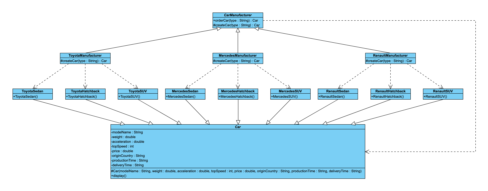
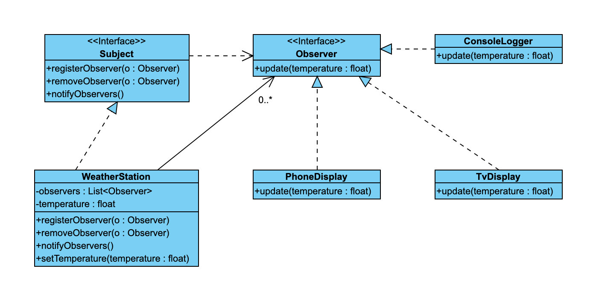

# vp-class-diagram

a [claude code](https://claude.com/claude-code) skill that turns java code into a uml class diagram that looks like visual paradigm output. it copies the same blue boxes, fonts, straight lines and arrowheads.



## what you get

- `diagram.html`: the diagram as a web page
- `diagram.png`: a sharp 2x screenshot, taken for you with headless chrome
- both files go next to your `src` folder, never inside it, so they don't end up in a `src` zip

## install

```bash
git clone https://github.com/DogukanUrker/vp-class-diagram ~/.claude/skills/vp-class-diagram
```

you need python 3. the png also needs google chrome, chromium, edge or brave. there are no packages to install.

## use

in claude code, inside your java project:

```
make the class diagram for this project
```

or run `/vp-class-diagram`. claude does these steps:
1. reads your `.java` files
2. writes a small json model of them
3. builds the page and the png
4. looks at the png and fixes the layout if anything overlaps

## what it draws

| java | uml |
|---|---|
| `extends` | solid line, white triangle |
| `implements` | dashed line, blue triangle |
| a field of another class | solid line, open arrow (or a diamond for aggregation / composition) |
| `new`, parameters, return types | dashed line, open arrow |

it also shows:
- abstract classes and methods in italic
- interfaces with an `<<Interface>>` label
- static members underlined
- multiplicity labels like `0..*`

it leaves out the test / main class on purpose.



## build by hand

```bash
python3 scripts/build.py examples/factory.json diagram.html
```

`SKILL.md` describes the model format. `examples/` has full models.

## note

this project is not made by visual paradigm, and has no link to it. it only copies the look of its class diagrams. it never adds visual paradigm's logo or watermark.

## license

[mit](LICENSE)
